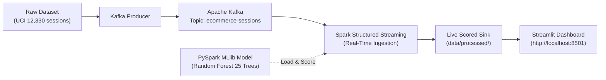

# Real-Time E-Commerce Analytics & Customer Purchase Prediction Platform

A distributed big data platform that ingests real-time customer browsing clickstreams, performs distributed analytics, and predicts purchase probability (`Revenue: TRUE/FALSE`) using a pre-trained **PySpark MLlib** pipeline model.

---

## 🏗️ Architecture



---

## 🛠️ Technology Stack

| Layer | Technologies | Purpose |
| :--- | :--- | :--- |
| **Ingestion** | Apache Kafka, Python Producer | Decoupled event streaming & buffering |
| **Batch Foundations** | PySpark RDDs | Low-level transformations (`map`, `filter`, `reduceByKey`) |
| **Structured Analytics**| PySpark DataFrames, Spark SQL | Catalyst query optimization & window functions (`DENSE_RANK`) |
| **Machine Learning** | PySpark MLlib (`pyspark.ml`) | Distributed Pipeline (`StringIndexer`, `OneHotEncoder`, `VectorAssembler`, `RandomForestClassifier`) |
| **Stream Processing** | Spark Structured Streaming | Micro-batch ingestion & live model scoring |
| **Presentation** | Streamlit + Plotly | Auto-refreshing live KPI cards, gauge & session feed |
| **Orchestration** | Docker & Docker Compose | Single-command multi-container deployment |

---

## 🎯 Model Performance & Key Findings

* **PySpark MLlib Test Evaluation (2,418 Sessions):**
  * **ROC-AUC Score:** `0.9174`
  * **PR-AUC Score:** `0.7530`
  * **Accuracy:** `90.20%`
  * **F1-Score:** `0.8908`
* **Empirical Insight:** Sessions with `PageValues > 50` convert at **81.13%** (5.2x higher than baseline). First-time visitors convert at **24.91%** compared to **13.93%** for returning visitors.

---

## 🚀 Quick Start

### Option 1: One-Command Docker Run (Recommended)

Make sure Docker Desktop is running, then run:

```bash
docker compose up --build -d
```

* **Dashboard Web UI:** Open [http://localhost:8501](http://localhost:8501)
* **Check Status:** `docker compose ps`
* **View Live Streaming Logs:** `docker compose logs -f streaming`
* **Stop Everything:** `docker compose down`

---

### Option 2: Local Step-by-Step Run (PowerShell)

```powershell
# 1. Activate Virtual Environment
.\cluster\Scripts\Activate.ps1

# 2. Run Module 1 (PySpark RDDs)
python src/analytics/01_rdd_analytics.py

# 3. Run Module 2 (Spark SQL Analytics)
python src/analytics/02_spark_sql_analytics.py

# 4. Run Module 3 (Train PySpark MLlib Model)
python src/ml/train.py

# 5. Start Live Pipeline (Open 3 Terminals)
python src/producer/kafka_producer.py --rate 0.8     # Terminal 1: Event Producer
python src/streaming/spark_streaming.py              # Terminal 2: Streaming Scorer
streamlit run dashboard/app.py                       # Terminal 3: Dashboard UI
```

---

## 📂 Repository Structure

```text
ecommerce-intelligence/
├── dashboard/
│   └── app.py                        # Streamlit + Plotly live monitoring dashboard
├── data/
│   ├── processed/                    # Scored sessions, monthly summary, metrics JSON
│   └── raw/                          # UCI Online Shoppers Purchasing Intention dataset
├── docs/
│   └── project_report.md             # Complete academic submission report
├── models/
│   └── spark_purchase_model/         # Serialized PySpark MLlib PipelineModel
├── notebooks/
│   └── exploratory_analysis.ipynb    # Jupyter Notebook for EDA & Spark SQL
├── src/
│   ├── analytics/                    # 01_rdd_analytics.py & 02_spark_sql_analytics.py
│   ├── ml/                           # train.py (PySpark MLlib distributed training)
│   ├── producer/                     # kafka_producer.py
│   └── streaming/                    # spark_streaming.py
├── tests/
│   └── test_pipeline.py              # Sanity tests (run with: pytest tests/test_pipeline.py)
├── docker-compose.yml                # Multi-service container orchestration
├── Dockerfile                        # Python 3.11 + OpenJDK 17 Spark container
├── requirements.txt                  # Python dependencies
└── Notes.md                          # Comprehensive step-by-step notes & viva Q&A
```
