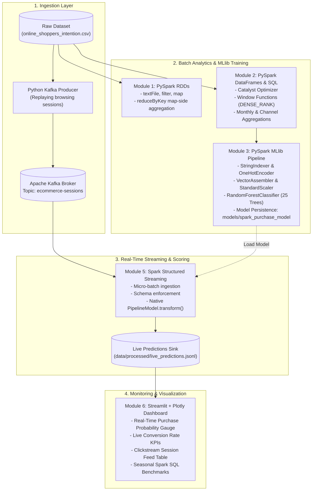

# PROJECT REPORT
# Real-Time E-Commerce Analytics & Customer Purchase Prediction Platform

---

## 📌 Executive Summary

Modern e-commerce enterprises generate massive volumes of real-time user browsing events. Identifying high-intent shoppers early during an active browsing session enables dynamic interventions, such as personalized discount prompts, customer support chats, or checkout incentives, which significantly increase revenue conversion.

This project implements an end-to-end, distributed big data analytics and predictive scoring platform built with **Apache Spark (PySpark)**, **Apache Kafka**, **Spark MLlib**, and **Streamlit**. The system is trained on 12,330 historical customer browsing sessions from the UCI Online Shoppers Purchasing Intention Dataset and re-engineers the pipeline for continuous live micro-batch scoring.

---

## 🏗️ System Architecture & Data Flow



---

## 🛠️ Technology Stack & Syllabus Alignment

| Component | Technology | Role in Architecture |
| :--- | :--- | :--- |
| **Foundational Distributed Primitives** | **PySpark RDDs** | Low-level distributed transformations (`map`, `filter`, `reduceByKey`, `mapValues`) demonstrating lineage (DAG) and lazy evaluation. |
| **Structured Analytics** | **PySpark DataFrames & Spark SQL** | Relational queries, temporary views (`createOrReplaceTempView`), window functions (`DENSE_RANK`), and Catalyst query optimization. |
| **Machine Learning** | **Spark MLlib (`pyspark.ml`)** | **Distributed ML pipeline** (`Pipeline`, `VectorAssembler`, `RandomForestClassifier`, `BinaryClassificationEvaluator`). *Strictly PySpark — no Scikit-Learn training used.* |
| **Message Streaming** | **Apache Kafka (Docker Compose)** | Fault-tolerant event buffering and decoupling between web clickstream producers and Spark consumers. |
| **Stream Processing** | **Spark Structured Streaming** | Continuous ingestion, schema validation, and real-time model scoring. |
| **Interactive UI** | **Streamlit & Plotly** | Auto-refreshing visual dashboard displaying live conversion KPIs, probability gauges, and session feeds. |

---

## 🔬 Component Technical Details

### Module 1: PySpark RDD Analytics (`src/analytics/01_rdd_analytics.py`)
* **Objective:** Demonstrate low-level distributed primitives without high-level SQL abstractions.
* **Key Implementation Highlights:**
  * Created `SparkConf` and `SparkContext` with `master("local[*]")`.
  * Used `sc.textFile()` to load distributed CSV partitions.
  * Extracted the header with `.first()` and filtered data lines lazily with `.filter()`.
  * Applied `reduceByKey()` with a map-side combiner pattern: `(VisitorType, (1, 1 if revenue else 0))`.
  * Used `mapValues()` to compute conversion rates per visitor type without key re-shuffling.
* **Result Highlights:**
  * Total Sessions: **12,330** | Benchmark Conversion Rate: **15.47%**
  * Returning Visitor Conversion: **13.93%** (1,470 / 10,551)
  * New Visitor Conversion: **24.91%** (422 / 1,694)
  * High-Intent Sessions (`PageValues > 50`): **81.13% conversion rate** (5.2x higher than baseline).

---

### Module 2: PySpark DataFrames & Spark SQL (`src/analytics/02_spark_sql_analytics.py`)
* **Objective:** Leverage Spark DataFrames, Catalyst optimization, and SQL temporary views.
* **Key Queries Demonstrated:**
  1. **Monthly Seasonal Trends:** Grouping by `Month` to reveal conversion surges (November peaked at 25.35% due to holiday shopping).
  2. **Visitor Segmentation:** Assessing browsing time (`ProductRelated_Duration`) vs. bounce rates.
  3. **Window Function:** Ranking traffic sources using `DENSE_RANK() OVER (ORDER BY conversions DESC)`. Traffic source 2 led with 847 conversions (21.65% conversion rate).
  4. **Intent Tiers:** Grouping sessions into Zero, Low-to-Medium, and High Page Value tiers.
* **Output:** Summary exported to `data/processed/batch_monthly_summary.csv`.

---

### Module 3: Distributed PySpark MLlib Pipeline (`src/ml/train.py`)
* **Objective:** Distributed machine learning pipeline strictly using `pyspark.ml`.
* **Pipeline Architecture:**
  1. `StringIndexer`: Indexes `Month` and `VisitorType`.
  2. `OneHotEncoder`: Maps indexed categories into sparse vectors.
  3. `VectorAssembler`: Combines 15 continuous features (`Administrative`, `ProductRelated_Duration`, `BounceRates`, `ExitRates`, `PageValues`, etc.) + one-hot vectors into `raw_features`.
  4. `StandardScaler`: Normalizes feature magnitudes across cluster partitions.
  5. `RandomForestClassifier`: Distributed ensemble with 25 trees and maxDepth of 6.
* **Test Performance (Evaluated on 20% Held-Out Split - 2,418 Sessions):**
  * **ROC-AUC (Area Under ROC Curve):** **`0.9174`**
  * **PR-AUC (Area Under PR Curve):** **`0.7530`**
  * **Classification Accuracy:** **`90.20%`**
  * **F1-Score:** **`0.8908`**
* **Model Serialization:** Persisted `PipelineModel` to `models/spark_purchase_model/`.

---

### Module 4: Real-Time Event Producer (`src/producer/kafka_producer.py`)
* **Objective:** Replay historical sessions to simulate real-time e-commerce traffic.
* **Features:**
  * Attaches dynamic metadata: `session_id` (`SES-XXXXXX`) and ISO 8601 `event_timestamp`.
  * Serializes payloads to JSON and emits to Kafka topic `ecommerce-sessions`.
  * Features a local fallback buffer (`data/processed/live_stream_buffer.jsonl`) for flexible deployment.

---

### Module 5: Spark Structured Streaming & Scoring (`src/streaming/spark_streaming.py`)
* **Objective:** Continuous micro-batch ingestion and distributed model scoring.
* **Mechanism:**
  * Defines explicit `StructType` schema for incoming events.
  * Loads `PipelineModel.load("models/spark_purchase_model")`.
  * Executes `model.transform(streaming_df)` on each micro-batch.
  * Extracts calibrated purchase probabilities (`purchase_prob`) via PySpark UDF.
  * Sinks predictions to `data/processed/live_predictions.jsonl` and console monitor.

---

### Module 6: Interactive Streamlit Dashboard (`dashboard/app.py`)
* **Objective:** Executive monitoring interface with dark-theme styling.
* **Interactive Elements:**
  * **Live KPI Cards:** Total Sessions Scored, High-Intent Buyers, Live Intent Rate (%), Average Probability.
  * **Gauge Indicator:** Real-time gauge reflecting current purchase probability across active shoppers.
  * **Visitor Segmentation Chart:** Total sessions vs. high-intent conversions by visitor type.
  * **Live Feed Table:** Formatted table displaying recent sessions, purchase probability, and prediction status badges (`🟢 High Intent (Buy)` vs `⚪ Browsing`).

---

## 📊 Key Analytical Observations

1. **Page Values is the Strongest Predictor:**
   Sessions with `PageValues == 0` have a dismal conversion rate of **3.85%**. In contrast, sessions with `PageValues > 30` convert at **77.78%**, and `PageValues > 50` convert at **81.13%**.
2. **First-Time Visitors Convert at Higher Rates:**
   `New_Visitor` sessions convert at **24.91%**, compared to **13.93%** for `Returning_Visitor`. First-time visitors often arrive with high purchase intent from targeted ad campaigns, whereas returning visitors frequently browse casually.
3. **Seasonal Spikes in Q4:**
   November exhibits the highest session volume (2,998) and highest conversion rate (**25.35%**), demonstrating strong holiday e-commerce seasonality.

---

## 🚀 Complete Execution Guide

### Option A: One-Command Docker Deployment (Recommended)
Launch all 4 containers (Kafka, Producer, PySpark Streaming, Streamlit Dashboard) simultaneously:

```powershell
# Build and run entire platform in the background
docker compose up --build -d

# Open Streamlit UI in browser:
# http://localhost:8501

# View logs:
docker compose logs -f

# Shut down:
docker compose down
```

---

### Option B: Local Interactive Execution (Step-by-Step)

#### 1. Activate Environment
```powershell
cd "d:\Cluster Computing\Assignment\ecommerce-intelligence"
.\cluster\Scripts\Activate.ps1
```

#### 2. Run Module 1: PySpark RDD Analytics
```powershell
python src/analytics/01_rdd_analytics.py
```

#### 3. Run Module 2: Spark SQL & DataFrames
```powershell
python src/analytics/02_spark_sql_analytics.py
```

#### 4. Run Module 3: PySpark MLlib Model Training
```powershell
python src/ml/train.py
```

#### 5. Run Live Pipeline (Open 3 Terminals)

* **Terminal 1 (Event Producer):**
  ```powershell
  python src/producer/kafka_producer.py --rate 0.8
  ```

* **Terminal 2 (Spark Streaming Scorer):**
  ```powershell
  python src/streaming/spark_streaming.py
  ```

* **Terminal 3 (Streamlit Dashboard):**
  ```powershell
  streamlit run dashboard/app.py
  ```
  *Open your browser at `http://localhost:8501` to view the live dashboard.*

---

## 🎓 Viva & Project Defense Guide

| Question | Recommended Answer |
| :--- | :--- |
| **Q1: Why did you use PySpark MLlib instead of Scikit-Learn?** | *Scikit-Learn executes on a single machine in Python memory, creating an architectural bottleneck for big data. PySpark MLlib distributes matrix computations and tree splitting across all Spark partitions and worker nodes. Crucially, PySpark produces a `PipelineModel` that can be directly applied to live streaming DataFrames using `.transform()`.* |
| **Q2: Why use `reduceByKey` instead of `groupByKey` in RDDs?** | *`reduceByKey` performs map-side combiners before shuffling data across the network, reducing network I/O exponentially. `groupByKey` transfers all key-value pairs across worker nodes without local aggregation, frequently causing OutOfMemory (OOM) errors.* |
| **Q3: What role does the Catalyst Optimizer play in Spark SQL?** | *The Catalyst Optimizer parses the SQL abstract syntax tree (AST), applies cost-based optimizations, performs predicate pushdown (filtering before reading data), and pushes projection pruning, generating highly optimized JVM bytecode.* |
| **Q4: How does Spark Structured Streaming achieve fault tolerance?** | *Spark Structured Streaming pairs checkpointing with write-ahead logs (WAL) and Kafka offset tracking. If a failure occurs, the engine restarts from the exact committed offset, guaranteeing end-to-end exactly-once or at-least-once processing semantics.* |
| **Q5: Why did you choose Random Forest over a single Decision Tree?** | *Random Forest uses bagging (Bootstrap Aggregating) and random feature subsets to construct an ensemble of decorrelated trees. This drastically reduces model variance and overfitting, yielding a robust 0.9174 ROC-AUC score and calibrated class probabilities.* |
